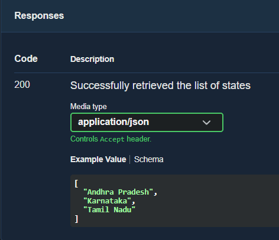
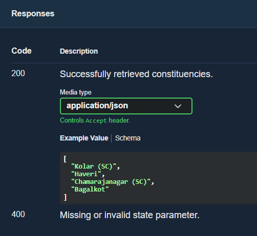
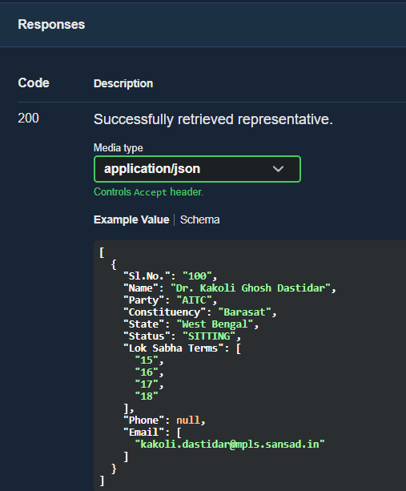
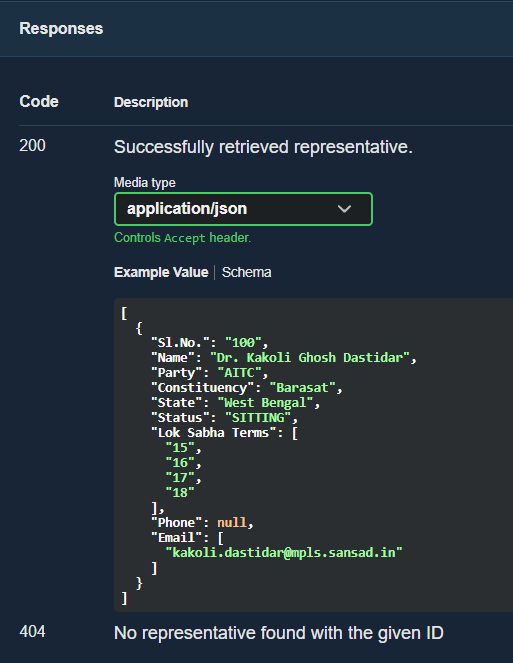
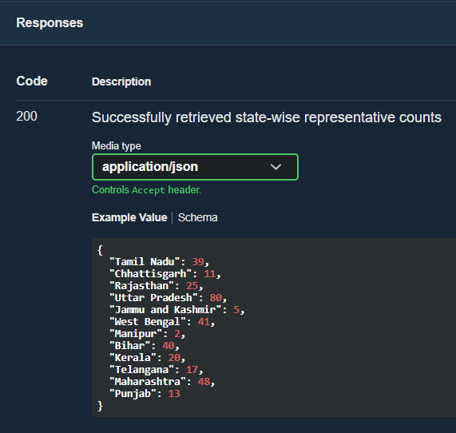

# Link to the site

[Hosted on Netlify](https://tinebmanas.netlify.app/)

# Instructions to run the code

## Frontend

```
Run code using VSCode Live Server
```

## Backend
- http://localhost:5000/

```
npm run start
```

# How representatives are filtered

Following table shows how the state, constituency and representative filters work on both the frontend and the backend.
| State | Constituency | Representative | Response |
| :--- | --- | --- | --- | 
| Empty | Empty | Empty | Empty |
| Karnataka | Empty | Empty | List of all the representatives from Karnataka |
| Karnataka | Bagalkot | Empty | Representative of Bagalkot from Karnataka |
| Karnataka | Bagalkot | raj | Representative of Bagalkot from Karnataka whose name contains the text "raj". Empty if the text doesn't match the representative's name |
| Karnataka | Empty | raj | Representatives from Karnataka whose names contain the text "raj". Empty if the text doesn't match any names |
| Empty | Bagalkot | raj | Not allowed. A constituency can't be chosen without a state |
| Empty | Empty | raj | List of all the representatives (irrespective of state) whose names contain the text "raj" |

# API

## Get states



## Get constituencies



## Get representatives



## Get representative by ID



## Get total number of representatives from each state



# Contribution

- I cleaned the data using an online excel to JSON converter
- Frontend
  - Built with HTML, CSS and JavaScript
  - Color palette comes from Tineb's official website
  - For responsiveness, I used CSS Flexbox
  - JSON file is read directly using JavaScript's Fetch API and manipulated, before being rendered using HTML and CSS
  - The table above shows how the filters work. Adding an additional filter narrows down the search
  - An empty phone number shows up as "Unavailable"
  - Emails can be copied to clipboard by clicking "Copy"
- Backend API
  - RESTful API documented using Swagger (References mentioned in the last section of this README)
  - For API documentation, refer to the previous section
  - I added an extra /counts route that responds with the number of representatives of each state

# References

- [UI and color palette inspiration from tineb's official site](https://thereisnoearthb.org/)
- [Online excel to JSON converter](https://jsonlove.com/tool/excel-to-json-converter-online/)
- [Backend : Implementing rep counts for each state](https://codesignal.com/learn/courses/javascript-map-in-practice-revision-and-application/lessons/counting-elements-using-maps-in-javascript)
- [Writing swagger documentation](https://dev.to/desmondsanctity/documenting-nodejs-api-using-swagger-4klp)
- [Writing the readme : Markdown to text editor](https://markdowntotext.com/)
